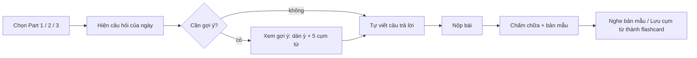

# PLAN: Tích hợp IELTS Speaking vào Flashcard App

> Mục tiêu: thêm 2 tính năng **Dịch câu đời thường** và **Luyện 1 câu IELTS mỗi ngày (có chấm chữa)**.
> Nguyên tắc: **1 người dùng → làm đơn giản nhất có thể**. Không server, không build, vẫn chạy trên GitHub Pages.

---

## 1. Quyết định kỹ thuật cốt lõi

| Vấn đề | Chọn | Lý do |
|---|---|---|
| AI dịch & chấm bài | **Gemini API** gọi thẳng từ trình duyệt (`fetch`) | Có gói free, không cần server, chỉ 1 người dùng |
| API key | Dán 1 lần vào ô Cài đặt → lưu `localStorage` | Không commit key lên GitHub |
| Ngân hàng câu hỏi | Mảng JS viết sẵn (~20 câu/Part) | Không tốn API, chạy offline, "câu của ngày" ổn định |
| Lưu lịch sử | `localStorage` (key riêng `speaking_v1`) | Đơn giản; đồng bộ Firebase để sau |
| Phát âm mẫu | Dùng lại hàm TTS `speechSynthesis` sẵn có | Không viết thêm |
| Code | **1 file mới `speaking.js`** + 1 khối HTML + ít CSS | `app.js` đã 130KB, không nhồi thêm |

> [!IMPORTANT]
> Vào Google AI Studio → giới hạn API key theo **HTTP referrer**: `thanh-2312.github.io/*` và `localhost:*`. Như vậy key có lộ cũng không ai dùng được.

---

## 2. Vị trí trong giao diện

- Màn hình chọn danh mục (`#selection-overlay`) thêm **nút thứ 3: 🎤 Speaking** cạnh *Words* / *Collocations*.
- Bấm vào → mở màn hình Speaking (ẩn khu flashcard), có **2 tab**:

```
┌─────────────────────────────────────────┐
│  ← Flashcards      [ Dịch ] [ Luyện đề ] │
├─────────────────────────────────────────┤
│              (nội dung tab)              │
└─────────────────────────────────────────┘
```

Dùng lại class CSS sẵn có (`form-textarea`, nút, card, toast, dark mode) → gần như không cần CSS mới.

---

## 3. Tính năng 1 — Dịch câu đời thường (Việt → Anh)

### Luồng
1. Gõ câu tiếng Việt (VD: *"Hôm nay tôi lười quá, chẳng muốn làm gì"*).
2. Bấm **Dịch** (hoặc `Ctrl+Enter`).
3. Nhận kết quả:

```
✅ Cách nói tự nhiên nhất:
   "I'm feeling so lazy today, I don't want to do anything."   🔊  ➕
💬 Thân mật hơn:  "Ugh, I can't be bothered to do anything today." 🔊  ➕
🎩 Lịch sự hơn:   "I'm not feeling very motivated today."          🔊  ➕
📝 Ghi chú: "can't be bothered" = chẳng buồn làm (rất hay dùng khi nói)
```

- 🔊 = nghe phát âm (TTS sẵn có)
- ➕ = **Lưu thành flashcard** (vào danh mục *Collocations*) → ôn lại bằng hệ thống 1-4-7-14 ngày sẵn có
- Lưu **20 câu dịch gần nhất** ngay bên dưới để xem lại.

### Prompt (gửi Gemini, yêu cầu trả về JSON)
```
You are a friendly English speaking coach for a Vietnamese beginner (A2-B1).
Translate this Vietnamese sentence into natural, everyday spoken English
(what a native speaker would actually say, not a word-by-word translation).
Return JSON only:
{
  "main": "most natural version, simple words",
  "casual": "more casual version",
  "polite": "more polite version",
  "note_vi": "1-2 short notes in Vietnamese about key phrases"
}
Vietnamese: """{input}"""
```

---

## 4. Tính năng 2 — 1 câu IELTS mỗi ngày + chấm chữa

### Luồng


### 4.1 Chọn câu hỏi
- 3 nút: **Part 1** (câu ngắn về bản thân) · **Part 2** (cue card, nói 1-2 phút) · **Part 3** (thảo luận).
- **Câu của ngày** = `questions[part][dayIndex % length]` với `dayIndex` tính theo ngày → mỗi ngày tự đổi, cùng ngày mở lại vẫn là câu đó.
- Nút **"Đổi câu khác"** nếu không thích câu hôm nay.
- Part 2 hiển thị kèm các gạch đầu dòng *You should say...*
- Hiện dấu ✅ nếu hôm nay đã làm (khuyến khích học đều mỗi ngày, có đếm **chuỗi ngày 🔥**).

### 4.2 Hỗ trợ người mới (điểm quan trọng nhất)
- **Được phép chêm tiếng Việt** khi bí từ. VD: *"I like đi phượt because it is relax"* → AI sẽ chỉ cách nói từ đó.
- Nút **💡 Gợi ý** (trước khi viết): AI đưa dàn ý 3 bước + 5 cụm từ hữu ích, giải thích bằng tiếng Việt.
- Gợi ý độ dài ngay dưới ô viết: Part 1: 2-4 câu · Part 2: 8-12 câu · Part 3: 3-5 câu (có đếm số từ).

### 4.3 Kết quả chấm chữa (hiển thị theo thứ tự dễ → khó)

| Khối | Nội dung |
|---|---|
| ⭐ Band ước tính | VD: `~5.0` (chỉ để tham khảo, kèm 1 câu nhận xét động viên) |
| ✏️ Bài của bạn đã sửa | Giữ nguyên ý của bạn, chỉ sửa lỗi; chỗ sửa được **tô màu** |
| ❌ Lỗi cần nhớ | Tối đa 3-5 lỗi: `sai → đúng — giải thích tiếng Việt` |
| 🟢 **Nói đơn giản** (B1) | Bản mẫu dễ nói, câu ngắn, từ quen thuộc 🔊 |
| 🔵 **Nói hay hơn** (Band 6.5-7) | Bản mẫu tự nhiên hơn, có idiom/collocation 🔊 |
| 🧩 Cụm từ đáng học | 3-5 cụm, mỗi cụm có nút ➕ lưu flashcard |
| 🎯 Lần sau hãy thử | 1 mẹo duy nhất (VD: "Thêm 1 ví dụ cá nhân sau mỗi ý") |

Sau khi xem, có nút **"Đọc to bản đơn giản 3 lần"** → bật TTS để nghe-nhại theo (shadowing).

### Prompt chấm bài (JSON)
```
You are a kind IELTS Speaking coach for a Vietnamese beginner (A2-B1).
The student wrote an answer (may contain Vietnamese words where they got stuck).
IELTS Part {part} question: "{question}"
Student answer: """{answer}"""
Return JSON only:
{
  "band": "estimated band, e.g. 5.0",
  "comment_vi": "1 encouraging sentence in Vietnamese",
  "corrected": "student's answer with minimal corrections, keep their ideas; wrap changed parts in **double asterisks**",
  "mistakes": [{"wrong": "...", "right": "...", "why_vi": "short Vietnamese explanation"}],
  "simple_version": "easy model answer a beginner can say (B1, short sentences)",
  "better_version": "natural band 6.5-7 model answer, same ideas",
  "phrases": [{"en": "useful phrase", "vi": "nghĩa tiếng Việt"}],
  "next_tip_vi": "ONE tip in Vietnamese for next time"
}
Max 5 mistakes, 3-5 phrases. Length of model answers suits Part {part}.
```

### Prompt gợi ý (JSON)
```
Give a Vietnamese beginner a hint to answer IELTS Part {part}: "{question}".
Return JSON only:
{ "outline_vi": ["bước 1", "bước 2", "bước 3"], "phrases": [{"en": "...", "vi": "..."}] }
```

---

## 5. Dữ liệu (localStorage)

```js
// key: 'speaking_v1'
{
  apiKey: '...',                 // KHÔNG export, KHÔNG đẩy lên Firebase
  translations: [{ vi, result, date }],          // giữ 20 bản gần nhất
  answers: [{ date, part, question, answer, feedback }], // lịch sử bài làm
  skip: { 1: 0, 2: 0, 3: 0 }     // số lần bấm "Đổi câu khác" trong ngày
}
```

**Lưu cụm từ thành flashcard**: tạo object đúng chuẩn trong `AGENT.md` (category `collocations`, `frontText` có `__________`, `acceptedAnswers`...) rồi gọi hàm thêm thẻ / lưu sẵn có trong `app.js` → tự đồng bộ Firebase như thẻ thường. Cần `app.js` lộ ra 1 hàm `window.addCard(card)`.
`frontText` lấy từ câu mẫu chứa cụm từ, thay cụm từ bằng `__________`.

---

## 6. Cấu trúc code

```
index.html   + nút Speaking trong selection overlay
             + <section id="speaking-view" hidden> (2 tab)
             + ô "Gemini API key" trong modal Cài đặt
             + <script src="speaking.js">
speaking.js  (mới, ~300 dòng)
  ├─ QUESTIONS = { 1: [...], 2: [{q, bullets}], 3: [...] }
  ├─ askGemini(prompt) → JSON         // 1 hàm fetch dùng chung
  ├─ translate()
  ├─ getTodayQuestion(part), hint(), submitAnswer()
  ├─ render kết quả + nút 🔊 / ➕
  └─ load/save localStorage
style.css    + vài class nhỏ cho khối kết quả (tô màu chỗ sửa, màu Simple/Better)
app.js       + window.addCard = ... ; window.speak = ...  (2 dòng)
```

Hàm gọi AI duy nhất:
```js
const MODEL = 'gemini-2.5-flash'; // đổi tên model ở đây nếu Google ra bản mới
async function askGemini(prompt) {
  const res = await fetch(
    `https://generativelanguage.googleapis.com/v1beta/models/${MODEL}:generateContent`,
    {
      method: 'POST',
      headers: { 'Content-Type': 'application/json', 'x-goog-api-key': state.apiKey },
      body: JSON.stringify({
        contents: [{ parts: [{ text: prompt }] }],
        generationConfig: { responseMimeType: 'application/json' }
      })
    });
  if (!res.ok) throw new Error(`Gemini lỗi ${res.status}`);
  const data = await res.json();
  return JSON.parse(data.candidates[0].content.parts[0].text);
}
```
Xử lý lỗi: chưa có key → mở Cài đặt; lỗi mạng/quota → toast + **giữ nguyên bài đang viết** (không mất chữ).
Bài đang viết dở tự lưu nháp vào `localStorage` mỗi khi gõ.

---

## 7. Các bước triển khai

| # | Việc | Kiểm tra xong khi |
|---|---|---|
| 1 | Tạo `speaking.js` + `askGemini()` + ô API key trong Cài đặt | Gọi thử trả về JSON |
| 2 | Nút Speaking + khung 2 tab trong `index.html` | Chuyển qua lại Flashcard ⇄ Speaking |
| 3 | Tab **Dịch** + lịch sử 20 câu + 🔊 | Dịch 1 câu, nghe được |
| 4 | Ngân hàng câu hỏi (~20 câu/Part) + câu của ngày + đổi câu | Mỗi ngày ra câu khác |
| 5 | Viết bài + nháp tự lưu + 💡 Gợi ý + Nộp + hiển thị chấm chữa | Nộp 1 bài thật, đủ 7 khối |
| 6 | Nút ➕ lưu flashcard (`window.addCard`) | Thẻ mới hiện trong Collocations |
| 7 | Chuỗi ngày 🔥 + ✅ đã làm hôm nay | Làm bài → hiện ✅ |
| 8 | Test mobile + dark mode, `node -c speaking.js`, commit & push | Chạy trên GitHub Pages |

Ước tính: **~1 buổi** làm việc.

---

## 8. Cố tình CHƯA làm (thêm khi thật sự cần)

- **Nói bằng giọng (Speech-to-Text)**: hiện tại tự viết theo yêu cầu. Khi muốn luyện nói thật → thêm nút 🎙️ dùng `webkitSpeechRecognition` (có sẵn trên Chrome), chữ nhận được đổ vào ô viết, phần chấm giữ nguyên.
- **Đồng bộ lịch sử Speaking qua Firebase**: chỉ thêm nếu hay làm bài trên cả điện thoại lẫn máy tính.
- **AI tự sinh câu hỏi mới**: ngân hàng có sẵn đủ dùng vài tháng; khi hết thì nhờ Agent thêm câu vào mảng.
- **Thống kê band theo thời gian / biểu đồ**: xem lịch sử bài làm là đủ.

---

## 9. Câu hỏi cần bạn xác nhận

1. Dùng **Gemini API** (miễn phí, cần tạo key ở aistudio.google.com) — OK không?
2. Phản hồi chấm chữa: giải thích bằng **tiếng Việt**, bài mẫu bằng tiếng Anh — đúng ý chưa?
3. Mức trình độ hiện tại tự đánh giá: khoảng **A2 hay B1**? (để chỉnh độ khó bản "Nói đơn giản")
4. Có muốn chủ đề câu hỏi theo **bộ đề quý hiện tại** (forecast) không, hay câu kinh điển chung là được?
